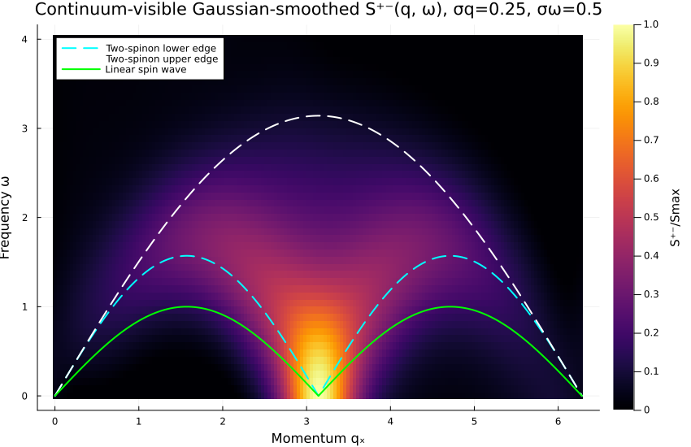
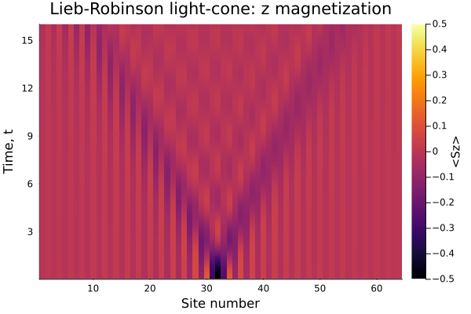

# DSSF

Julia tools for generating a spin lattice, finding its ground state with DMRG,
evolving a local spin excitation with TDVP, and analyzing magnetization and
the dynamical structure factor \(S^{+-}(q,\omega)\).

## Requirements

- Julia 1.12
- Packages listed in `Project.toml` and pinned by `Manifest.toml`

Set up the Julia environment from the repository root:

```sh
julia --project=. -e 'using Pkg; Pkg.instantiate()'
```

## Workflow

Run commands from the repository root so scripts and notebooks find the
canonical input and output paths.

The repository keeps the existing script and notebook paths for simple
command-line use:

```text
DMRG.jl                    Ground-state DMRG
lattice.jl                 Bond and site-coordinate generation
time_evolution.jl          TDVP evolution and checkpointing
calculating_Sqw.jl         FFT-based structure-factor output
mag_z_vs_time.ipynb        Magnetization plots and measured front speed
Sqw_pm.ipynb               Structure-factor analysis and plots
results/                   Example CSV data and exported figures
```

1. Generate a 64-site isotropic Heisenberg chain (the default couplings are
   both 1.0):

   ```sh
   julia --project=. lattice.jl 64
   ```

   This writes `bonds.txt` and `sites.dat`. The bond file stores
   `site1 site2 Jzz Jxx`; other lattice geometries can be supplied by editing
   the bond list written by `lattice.jl`.

2. Find the ground state:

   ```sh
   julia --project=. DMRG.jl
   ```

   The energy, ground-state MPS, and ground-state observables are written under
   `results/`.

3. Evolve a local excitation at site 32 to time 11.31 with time step 0.01:

   ```sh
   julia --project=. time_evolution.jl 11.31 0.01 32
   ```

   Magnetization and response samples are written to
   `results/time_evolution/mag_z.csv` and `response_pm.csv`. The final MPS
   checkpoint is saved alongside them. Continue a compatible checkpoint with:

   ```sh
   julia --project=. time_evolution.jl 12.0 0.01 32 --resume
   ```

4. Compute the FFT-based structure factor:

   ```sh
   julia --project=. calculating_Sqw.jl
   ```

   This writes `results/Sqw_pm.csv`. Optional arguments are
   `[q_points] [qx_max] [qy]`.

5. Open `mag_z_vs_time.ipynb` and `Sqw_pm.ipynb` in VS Code/Jupyter with the
   repository Julia environment active. Execute their cells from top to
   bottom. The structure-factor notebook shows the linear and contrast-scaled
   plots; the magnetization notebook shows the site-resolved signal and
   light-cone. After running the analysis cells, run each notebook's final
   figure-export cell to refresh the standalone PNGs.

## Repository data and figures

The CSV and text files under `results/` are included as reproducible sample
data for the notebooks. The notebooks also retain their rendered cell outputs
for GitHub previews. The exported PNGs under `results/figures/` provide
standalone versions of those plots.

- `results/time_evolution/response_pm.csv` is the response data used by
  `Sqw_pm.ipynb`.
- `results/time_evolution/mag_z.csv` is the site magnetization data used by
  `mag_z_vs_time.ipynb`.
- `results/Sqw_pm.csv` is the standalone FFT script output.

### Structure factor



Other structure-factor plots are available as
[linear](results/figures/sqw_linear.png),
[log-scaled](results/figures/sqw_log.png), and
[smoothed linear](results/figures/sqw_smoothed_linear.png) PNGs.

### Magnetization



Also see the [site-resolved magnetization](results/figures/magnetization_sites.png)
and [measured front-velocity fit](results/figures/magnetization_front_velocity.png).

DMRG and TDVP checkpoint files (`psi0.jld2` and
`results/time_evolution/final_state.jld2`) are generated locally and excluded
from Git. Recreate them by running DMRG and time evolution as needed.
